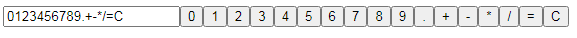

  

    
  

## Minimaalne HTML-kalkulaator

Ülimalt kompaktne kalkulaator, mis on loodud puhta HTML-i ja JavaScriptiga. Kõik kalkulaatori nupud genereeritakse automaatselt lihtsa for...of tsükli abil ning nende vajutusi töötleb üksainus sündmusekäsitleja.

# Omadused:

* Põhitehted: liitmine, lahutamine, korrutamine ja jagamine.
* Numbrinupud (0–9).
* Tühjendamine (C) ja arvutamine (=).
* Ei vaja väliseid teeke ega CSS-i.
* Kogu kalkulaator on kirjutatud vaid mõne koodireaga.

Väike näide JavaScripti koodigolfist!
